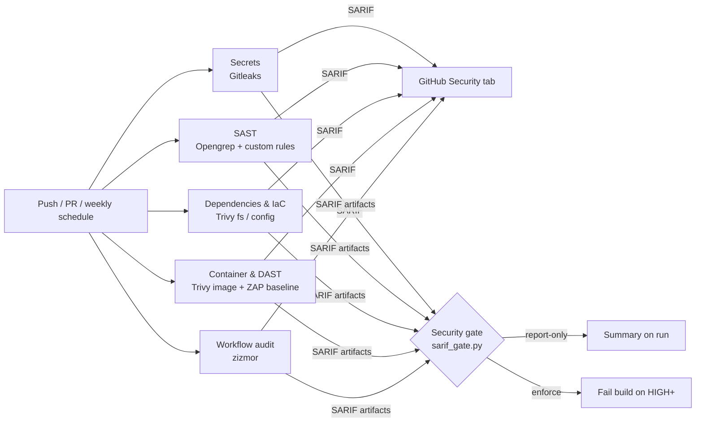

# AppSec Pipeline Demo

**A layered security pipeline in GitHub Actions: secrets, SAST, SCA, IaC, container and DAST scanning, with results normalised into one gate.**

> ⚠️ The application in this repo is **intentionally vulnerable**. It exists only so the pipeline has real issues to find. Never deploy it.

---

## Why this exists

Most "add security scanning to CI" examples stop at running one tool. In practice the hard parts are elsewhere:

- **Coverage.** No single scanner sees everything. Each layer catches a different class of issue.
- **Signal.** Five tools report severity five different ways. Developers need one answer: does this block my merge?
- **Trust in the pipeline itself.** A CI job that downloads and runs unpinned third-party code is a supply-chain risk. That risk became concrete when popular Actions had their release tags hijacked.
- **Adoption.** Teams need to see findings before a gate starts blocking them.

This repo is a small, working reference that addresses each of those.

## Architecture



| Layer | Tool | What it scans |
|---|---|---|
| Secrets | [Gitleaks](https://github.com/gitleaks/gitleaks) | Full git history, so a key "deleted" in a later commit is still caught |
| SAST | [Opengrep](https://github.com/opengrep/opengrep) | Python source, using the custom rules in [`rules/`](rules/) |
| SCA | [Trivy](https://github.com/aquasecurity/trivy) `fs` | `app/requirements.txt` against known CVEs |
| IaC | Trivy `config` | `Dockerfile` and `infra/*.tf` misconfigurations |
| Container | Trivy `image` | Built image: OS packages and installed libraries |
| DAST | [OWASP ZAP](https://www.zaproxy.org/) baseline | The running app (passive scan) |
| CI/CD | [zizmor](https://github.com/zizmorcore/zizmor) | This repo's own workflow files |

## What gets found

| Planted issue | Where | CWE | Caught by |
|---|---|---|---|
| SQL injection | `/user` | CWE-89 | Opengrep |
| OS command injection | `/ping` | CWE-78 | Opengrep (taint: request → `shell=True`) |
| SSRF | `/fetch` | CWE-918 | Opengrep (taint: request → `requests.get`) |
| Server-side template injection / XSS | `/hello` | CWE-1336 | Opengrep |
| Unsafe YAML deserialization | `/import` | CWE-502 | Opengrep, plus Trivy (vulnerable PyYAML) |
| Pickle deserialization | `/restore` | CWE-502 | Opengrep |
| Debug mode / Werkzeug debugger | `app.run` | CWE-489 | Opengrep |
| Hard-coded Flask `SECRET_KEY` | `app.py` | CWE-798 | Opengrep |
| Hard-coded API key | `app.py` | CWE-798 | Gitleaks |
| Outdated Flask, Werkzeug, Jinja2, requests, urllib3, PyYAML | `requirements.txt` | CWE-1395 | Trivy fs + image |
| End-of-life base image, runs as root, no healthcheck | `Dockerfile` | — | Trivy config + image |
| Public S3 bucket, SSH open to 0.0.0.0/0, IMDSv1, unencrypted volume | `infra/main.tf` | — | Trivy config |
| Missing security headers and similar | Running app | — | ZAP baseline |

**The overlap and the gaps are the point.** A passive DAST scan finds none of the injection flaws that SAST flags in seconds. SAST knows nothing about a CVE in a pinned library or a public S3 bucket. Layers matter.

## Design decisions

**1. No third-party Marketplace actions.** Each scanner is downloaded at a pinned version and its SHA-256 is verified before it runs. A compromised or re-tagged upstream release fails the checksum instead of executing in CI with repository access. The only actions used are GitHub's own (`checkout`, `upload-artifact`, `download-artifact`, `codeql-action/upload-sarif`), and those are pinned to full commit SHAs. Dependabot keeps them current, with a 7-day cooldown so brand-new releases age before adoption.

**2. Least privilege.** The workflow-level default is `permissions: {}`. Each job requests only `contents: read`, plus `security-events: write` where it uploads SARIF. Checkout uses `persist-credentials: false`, so the token is not left on disk for later steps.

**3. The pipeline audits itself.** zizmor scans the workflow for unpinned actions, template/script injection, excessive permissions and similar CI/CD weaknesses. It currently reports zero findings.

**4. One gate, normalised severity.** [`scripts/sarif_gate.py`](scripts/sarif_gate.py) merges all SARIF reports. Severity comes from the rule's numeric `security-severity` when the tool provides one, otherwise from the SARIF level. Leaked secrets are always treated as high. It writes a single summary table to the run and decides pass/fail. It uses only the standard library, so nothing extra is installed.

**5. Report-only first, then enforce.** The gate defaults to report-only, so teams see findings before builds start breaking. Flip it with repository variables, no code change needed:

| Variable | Values | Default |
|---|---|---|
| `SECURITY_GATE_ENFORCE` | `true` / unset | unset (report-only) |
| `SECURITY_GATE_FAIL_ON` | `critical`, `high`, `medium`, `low` | `high` |

These values reach the script through environment variables, never through `${{ }}` interpolation inside `run:`, which would allow script injection.

**6. A crashed scanner is not a clean scan.** The gate runs even if a scanner job fails (`if: always()`), still reports what it has, and then fails the build. A broken tool should never look like "0 findings".

**7. Custom rules are tested like code.** Every Opengrep rule has positive and negative test cases in [`rules/python-flask.py`](rules/python-flask.py). `opengrep test` runs in CI before the scan, so a rule that silently stops matching breaks the build. The taint-mode rules (command injection, SSRF) only fire when request data actually reaches the sink, which keeps false positives down.

**8. Weekly scheduled run.** New CVEs are published against code that hasn't changed. The Monday run catches them.

## Repository layout

```
.github/
  workflows/security.yml   the pipeline
  dependabot.yml           keeps pinned actions current
app/                       intentionally vulnerable Flask app
infra/main.tf              intentionally misconfigured Terraform (never applied)
rules/                     custom Opengrep rules + their test cases
scripts/sarif_gate.py      SARIF merge, severity normalisation, gate
Dockerfile                 intentionally insecure image
```

## Running the scanners locally

```bash
# SAST: test the rules, then scan
opengrep test rules/
opengrep scan --config rules/python-flask.yaml --exclude rules .

# Secrets
gitleaks git --redact .

# Dependencies, IaC, image
trivy fs --scanners vuln app/
trivy config .
docker build -t appsec-demo . && trivy image appsec-demo

# Gate over any SARIF files you produced
python3 scripts/sarif_gate.py *.sarif --fail-on high
```

## Roadmap

- [ ] Fix each vulnerability in its own pull request, showing the alert close in the Security tab and the gate go green
- [ ] Gate only on **new** findings in a PR (baseline diff) so legacy debt doesn't block unrelated work
- [ ] Convert ZAP output to SARIF and include it in the gate
- [ ] Generate an SBOM (CycloneDX) and sign the image with cosign
- [ ] Package the scan jobs as a reusable workflow callable from other repos in one line
- [ ] Policy-as-code checks for Terraform with OPA/Conftest

## Author

**Chris Basnage**: Application security, CISSP · GWEB · GWAPT
[LinkedIn](https://www.linkedin.com/in/YOUR-PROFILE)

## License

MIT. See [LICENSE](LICENSE).
